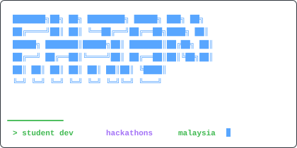

 

**Student developer from Malaysia. I like hackathons.**

I learn by shipping — most of what's here was built in 24–48 hours
with a team, a deadline, and not enough sleep.

 

### Projects

**[Naruto UTP](https://github.com/Fly-Tan/naruto-utp)** · MediaPipe hand tracking, Rasengan in your palms
&nbsp;·&nbsp; [live ↗](https://naruto-utp.vercel.app)

**[Ryokō](https://github.com/Fly-Tan/Ryoko-travel-planner)** · AI travel co-pilot for groups
&nbsp;·&nbsp; [live ↗](https://ryoko-travel-planner.vercel.app)

**[OracleSort](https://github.com/Fly-Tan/OracleSort)** · sorting algorithm visualiser
&nbsp;·&nbsp; [live ↗](https://fly-tan.github.io/OracleSort/)

 

<b>More hackathon builds</b>

 

| Project | Event |
|---|---|
| [Van Guard](https://github.com/Fly-Tan/Van_Guard) | DataWorks Challenge 2026 |
| [Umbrella](https://github.com/Fly-Tan/Umbrella) | Electrohack 2.0 |
| [Farm Thinking](https://github.com/Fly-Tan/Farm-Thinking) | UTM Hackathon 2026 |
| [Talent Compass](https://github.com/Fly-Tan/Talent-Compass) | APU Hackathon |
| [Dormathon](https://github.com/Fly-Tan/dormathon) | team project |
| [Fly ASCII](https://github.com/Fly-Tan/Fly_ASCII) | terminal rendering experiments |

 

`Python` `JavaScript` `HTML/CSS` `C++`

