<!-- GitHub Profile Agent Console hero + custom CTF layer -->

  <picture>
    <source media="(max-width: 760px) and (prefers-color-scheme: dark)" srcset="./assets/hero/agent-console-941ccd9f-mobile-dark.svg">
    <source media="(max-width: 760px)" srcset="./assets/hero/agent-console-941ccd9f-mobile-light.svg">
    <source media="(max-width: 760px) and (prefers-color-scheme: light)" srcset="./assets/hero/agent-console-941ccd9f-mobile-light.svg">
    <source media="(min-width: 761px) and (prefers-color-scheme: dark)" srcset="./assets/hero/agent-console-941ccd9f-dark.svg">
    <source media="(min-width: 761px) and (prefers-color-scheme: light)" srcset="./assets/hero/agent-console-941ccd9f-light.svg">
    
  </picture>

 

  

  

 

**Student developer from Malaysia. I like hackathons.**

 

## Current Focus

| Area | What I am exploring |
| --- | --- |
| **CTF & Exploitation** | Solving pwn, web, forensics, and crypto challenges under time pressure. |
| **Hackathon Builds** | Shipping complete products in 24-48 hours with a small team. |
| **Browser Vision** | Real-time hand tracking and CV that runs client-side, no server. |

## Featured Work

| Project | Focus | Why it matters |
| --- | --- | --- |
| [**Naruto UTP**](https://github.com/Fly-Tan/naruto-utp) | MediaPipe hand tracking | Real-time hand tracking that conjures a Rasengan between your palms. Runs entirely client-side on 21 tracked landmarks per frame. [Live](https://naruto-utp.vercel.app) |
| [**Ryokō**](https://github.com/Fly-Tan/Ryoko-travel-planner) | AI travel co-pilot | An AI travel co-pilot for groups built for CodeNection 2026. The hard part was getting four people with different budgets to agree. [Live](https://ryoko-travel-planner.vercel.app) |
| [**OracleSort**](https://github.com/Fly-Tan/OracleSort) | Algorithm visualiser | Watch sorting algorithms fight over the same dataset. Built for UM Hackathon 2026, team Winnie Fly. [Live](https://fly-tan.github.io/OracleSort/) |

<b>More hackathon builds</b>

 

| Project | Event |
| --- | --- |
| [Van Guard](https://github.com/Fly-Tan/Van_Guard) | DataWorks Challenge 2026 |
| [Umbrella](https://github.com/Fly-Tan/Umbrella) | Electrohack 2.0 |
| [Farm Thinking](https://github.com/Fly-Tan/Farm-Thinking) | UTM Hackathon 2026 |
| [Talent Compass](https://github.com/Fly-Tan/Talent-Compass) | APU Hackathon |
| [Dormathon](https://github.com/Fly-Tan/dormathon) | team project |
| [Fly ASCII](https://github.com/Fly-Tan/Fly_ASCII) | terminal rendering experiments |

## Tech Stack

`Python` · `JavaScript` · `HTML/CSS` · `C++` · `MediaPipe` · `OpenCV` · `Git` · `CTF`

---

  

